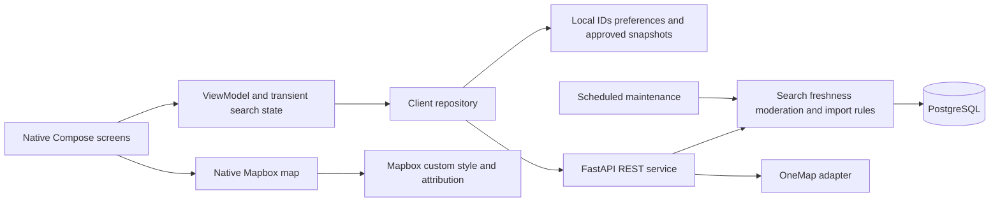

# FoodBridge Navigator build plan

Build a native Android application that helps someone find suitable Singapore food support, understand what is confirmed, and contact or travel to a provider. Deliver the complete Lab functional scope, including administrator moderation and authorised imports. Use the reference screens for visual direction and the Lab requirements for behaviour.

## Source authority and scope

Reviewed `reference/stitch_foodbridge_navigator/SC2006 Labs.docx`, its embedded use case, class and dialog diagrams, all eleven HTML screen exports, the reference PRD and DESIGN.md. The repository initially contains references and their ZIP, with no application implementation.

Precedence: the user's explicit Android and complete-requirements instruction; numbered Lab functional and nonfunctional requirements; latest Lab use case descriptions; PRD product ideas; mockup copy and sample data. The original AI stack discussion explicitly says it is a starting point, so it is not a fixed architecture mandate.

## Stack decision

| Layer | Decision | Reason |
|---|---|---|
| Android client | Kotlin, Jetpack Compose, Material 3, minSdk 31 | Native Android 12+ delivery, accessible controls, reliable permissions and lifecycle |
| Client architecture | ViewModel, StateFlow, repositories, coroutines | Keep views independent from network and business rules |
| Device storage | DataStore for bookmark IDs and optional diet preferences; approved detail cache | Anonymous saving across sessions; never persist device coordinates |
| Maps | Native Mapbox Android SDK with bundled custom Standard style | User requested Mapbox on 3 October; map opens immediately with native floating search and filters. Mapbox supplies walking/driving routes; OneMap supplies address geocoding and public transport. Public Mapbox token is supplied through ignored local configuration. |
| API | Python FastAPI, Pydantic, SQLAlchemy | Clear validation, OpenAPI contract, straightforward course-team implementation |
| Database | PostgreSQL in production; SQLite for an immediately runnable local prototype | Production concurrent moderation and durable storage; local setup works without a database daemon |
| Operations | Containerised API, managed PostgreSQL, one scheduled maintenance command | One service and one database; no message broker needed |
| Authentication | Provisioned administrator accounts, Argon2 hashes, expiring bearer sessions | Public users need no account; server authorises every protected operation |

Compose is Android's recommended modern UI toolkit, and its architecture guidance supports ViewModels and repositories ([Android architecture](https://developer.android.com/topic/architecture/recommendations)). DataStore is intended for small preference data ([DataStore](https://developer.android.com/topic/libraries/architecture/datastore)). These are source-backed capabilities; the stack choice is a project-specific judgement. PostgreSQL supports row locking for concurrent decisions ([locking](https://www.postgresql.org/docs/current/explicit-locking.html)). FastAPI's deployment guidance covers process replication and migrations ([deployment](https://fastapi.tiangolo.com/deployment/concepts/)).

Use pinned, compatible build tools rather than chasing the newest release: AGP 8.13, Gradle 8.13, JDK 17 and compile SDK 35. API 31 is the minimum device level. Update target SDK to the store's required level before distribution. [AGP compatibility](https://developer.android.com/build/releases/agp-8-13-0-release-notes).

## Contradictions resolved

| Source conflict or gap | Implementation decision |
|---|---|
| PRD PWA versus Lab Android 12+ | Native Android is the release product. HTML exports are design references. |
| PRD surplus marketplace versus approved-service directory | Complete the directory first. Surplus sharing is a separate later product phase; no instant unmoderated publication. |
| PRD sign-in required for bookmarks versus UC-05 same-device saves | Bookmarks and preferences work anonymously and locally. |
| Signed-in profile mockup versus guest-first Lab | Replace Profile with Preferences. Staff sign-in is a separate entry. |
| Automatic location and location toggle versus explicit permission and privacy | Ask only after Use my location. No background location; clear coordinates when session ends, exclude them from logs, backups and saved state. |
| London map, UK Trussell helpline, Citizens Advice, miles | Singapore maps, kilometres and Singapore-specific verified help content. Remove all UK guidance. |
| Fake Harmony addresses differ across screens | One canonical record per service. Reference names and addresses are demo fixtures, visibly identified; never present them as verified real services. |
| Open badge used as availability evidence | Operating hours and food availability are separate. A schedule never proves food exists. |
| EXPIRED database state versus UNKNOWN public label | Persist EXPIRED via maintenance; also compute expiry on reads to prevent stale available badges. Public copy is Availability unknown. |
| Confidence only required for food banks but displayed for all evidence | Store optional confidence for other services and required confidence for food-bank observations. Never invent confidence for missing data. |
| Every mandatory filter versus fuzzy recommendations | Apply hard filters first. Unknown dietary/accessibility facts do not meet selected mandatory criteria. Never silently relax filters. |
| Multiple selected diets versus Halal-or-Vegetarian shortcut | Every selected dietary requirement must be confirmed; do not combine them with OR. Free-text needs are displayed for provider confirmation and cannot silently imply a match. |
| Travel time for every result versus 0.5-second cached search | Return approved local results immediately; request paginated ETA enrichment asynchronously with bounded concurrency. Route failure does not remove results. |
| Approval before editing in admin dialog versus publish on approval | Editing prepares a proposal. Approve and publish is one transaction with its audit entry. No intermediate approved-but-unsaved state. |
| UC-06 direct updates versus moderated proposals | Authenticated administrator direct updates are explicit approve-and-publish decisions with audit entries; public reports never publish directly. |
| Organisation change requests without provider UI or actor | Provide an authenticated administrator ingestion/creation endpoint and authorised import path. No self-service provider portal is required. |
| Diagrams use inconsistent UC numbers | Canonical UC-01 search, 02 details, 03 route, 04 report, 05 saved, 06 update, 07 report status. Add moderation/import use cases to cover 4.3 and 4.5. |
| Search includes details and saved extends details in older UML | Navigation is not automatically an include/extend relationship. Route/report optionally extend detail; saved and search independently lead to detail. |
| UC-02 preconditions duplicate postconditions | Precondition: an identifiable approved service exists. Postcondition: details and evidence are visible. |
| UC-04 copied route assumptions | Replace with valid service ID and connectivity for submission. |
| Empty saved screen versus precondition requiring saved item | Allow opening Saved with zero bookmarks and show recovery action. |
| Search/Route entities suggest durable origin storage | Treat them as transient domain objects, not user-location database records. |
| No preferred date/time on Home reference | Add expandable When field with Singapore time and date validation. |
| Headerless and single-screen PRD versus DESIGN headers and accessibility | Use a small branded app bar and four labelled tabs. Permit scrolling and larger fonts; never clip content to force one-page fit. |
| 44px web targets versus native Android controls | Use at least 48dp touch targets, text labels and screen-reader semantics. |
| DESIGN token and prose colours/radii disagree | Teal #00535B, pale background #F7F9FF, white cards, 16dp cards and 12dp fields, one shared token source. |
| Fixed 2024 calendar and differing meal schedules | Derive dates from current Singapore time and the canonical approved schedule. |
| Instant safe-handling/certified/photo claims | Remove unsupported guarantees and fabricated impact claims. Dietary certifications require evidence. |
| 1/2/3-hour drop expiry presented as food safety or legal protection | Listing expiry is not a safety determination; future sharing needs source preparation/storage/allergen/consume-by evidence and policy review. SFA guidance imposes conditions; no blanket protection claim. [SFA food donation guidance](https://www.sfa.gov.sg/food-safety-tips/safe-food-practices/food-donation). |
| Zero personal information claim on report form | Say No account required. Explain that free text may contain personal details; discourage including them. |
| Lab references absent lab 1.md, Lab2_Analysis.md, ui-mockups.md | Use supplied DOCX and embedded diagrams; do not fabricate contents of missing files. |
| PRD status Approved / In Review | This plan is the chosen implementation baseline; source status is ambiguous and not proof of sign-off. |

## Product and frontend decisions

Use a calm, legible interface: deep teal, quiet surfaces, generous spacing and a clear heading hierarchy. All availability badges include text and an icon. Map opens immediately with overlaid search; list and map share exactly the same filtered service results. A separate provider directory covers contact-based support, including vouchers/referrals and programmes without confirmed collection coordinates. It labels source review limits and does not imply mandatory dietary matches or current stock.

Four labelled tabs: Find, Map, Saved, Preferences. Home explains that browsing is private and needs no account, with one origin input and Use my location. Keep common filters visible (distance, service type, diet); put scheduling and accessibility into expanded filters. Preserve the user's input on errors and navigation. Use an editable Across Singapore area (80 km) initially, walking as the initial route mode, and current Singapore time unless a preferred time is selected.

Result cards show organisation, support type, metric distance, eligibility summary, operating status, food availability, last checked time and why it matches. Use save actions with clear state, and tap the card for details. Show a specific no-results explanation and edit-filters action. Do not add irrelevant rankings, donation pitches, social features or urgency animations to a seeker journey.

Details prioritise the location, availability, eligibility, next service window, route and approved contact methods. Always include Contact the organisation before travelling. Evidence lists source, observation, expiry and confidence. Missing data says Not confirmed. Route failure retains details. Saved items fetch latest approved data; offline snapshots are clearly marked and expired evidence is recalculated locally.

Administrator screens include sign-in, reports/change queue, current-versus-proposed comparison, editable proposal, approve-and-publish, rejection reason, service editor, duplicate review, quarantined imports, source health and audit history. Staff screens use the same Android application, with server-side permissions.

## Architecture and responsibility boundaries

The client owns presentation, permissions and local saves. The API owns approval visibility, validation, distance, ranking, freshness, authentication and transactions. External providers are accessed through adapters with finite timeouts. Import failure preserves the last successful approved dataset. The native map never receives administrator credentials.

## Domain model

Organisation owns one or more services. Service owns schedules, dietary evidence and availability observations. Store locations at service level so an organisation can distribute at multiple sites. Each organisation/service carries source, import time and verification time. Schedules contain local weekdays, intervals and date-specific exceptions; calculate OPEN/CLOSED/UNKNOWN at a requested instant in Asia/Singapore. Use UTC for stored instants and Singapore time for display.

AvailabilityObservation: status AVAILABLE/LIMITED/UNAVAILABLE/UNKNOWN/EXPIRED; source; observed_at; valid_until; optional HIGH/MEDIUM/LOW confidence, mandatory for food banks. Pick the latest valid approved observation by timestamp, never treating a correction submission as an observation. Preserve original status for historical evidence even after expiry.

CorrectionReport: service ID, unique unguessable reference, category, trimmed 1–1000 character description, optional evidence URL, submission time and PENDING/APPROVED/REJECTED state. ChangeRequest: target, base version, proposed fields, source and pending state. ModerationDecision and append-only AuditEntry identify actor, action, target, timestamp, before/after and rejection reason. Use a conditional pending-to-decided update and transaction to prevent duplicate decisions; reject stale base versions with a conflict.

ImportRun records source, permission/export metadata, counts, started/finished times and last success. QuarantineRecord retains raw invalid records and reasons. DuplicateCandidate links suspected organisation pairs for review. AdminAccount stores a role and password hash; sessions store only token hashes and expiry.

## API contract

| Endpoint family | Behaviour |
|---|---|
| POST /api/search | Resolved lat/lon, radius, diets, type, preferred instant and optional open-only criterion; default limit10; approved results with explanations |
| POST /api/geocode | Six-digit postal or Singapore address; validation, candidate selection, finite timeout and local seed-address fallback |
| GET /api/services and /api/services/{id} | Approved canonical details, evidence, provenance and latest update |
| POST /api/routes | Origin, service ID and travel mode; OneMap geometry, distance and duration or explicit unavailable response |
| POST /api/reports | Anonymous service/provider target validation, category/description/evidence and reference; published records unchanged |
| POST /api/admin/login and /logout | Provisioned accounts and expiring sessions |
| GET /api/admin/reports, /changes, /audit, /sources, /quarantine, /duplicates | Protected operational data |
| POST /api/admin/reports/{id}/decision | Rejection reason or validated proposal; single atomic decision |
| PATCH /api/admin/services/{id} | Version-checked authorised update with audit |
| POST /api/admin/changes and /changes/{id}/decision | Organisation/service proposals and moderated publication |
| POST /api/admin/import | Authorised JSON export, per-record validation, quarantine and duplicate review |
| POST /api/admin/duplicates/{id}/decision | Resolve or merge with audit and preserved service ownership |
| GET /health/live and /health/ready | Liveness and database readiness without private data |

Errors use actionable messages and structured details. Validate Singapore bounds, finite coordinates, positive bounded radii, supported enum values, future validity, safe website schemes and existing targets. Bound payload sizes and result pagination. Apply public report/login throttles without durable location tracking.

## Search and routing rules

1. Validate origin and criteria. Resolve ambiguous address candidates explicitly.
2. Select published active services. Filter every mandatory diet/accessibility/type/distance/time criterion.
3. Calculate straight-line kilometres with Haversine. Label route distance separately.
4. User instruction on3 October overrides earlier ranking: after mandatory filtering, order by unrounded Haversine distance, then stable ID. Android requests limit10 and shows up to10 nearest matches; return fewer when fewer qualify. Do not invent coordinates for directory-only providers. Explain suitability using actual matching facts.
5. Return local results independently from OneMap. Enrich travel times asynchronously for each returned page, with at most three simultaneous requests and a 4-second client deadline.
6. Route with a total bounded deadline, safe server-side token refresh, and decoded geometry. Preserve service details on all failures.

The app offers Walk, Public transport and Drive. Walking/driving use Mapbox Directions with the configured public token. Public transport uses OneMap ([routing](https://www.onemap.gov.sg/apidocs/routing)); production credentials stay server-side ([authentication](https://www.onemap.gov.sg/apidocs/authentication)). Preserve required OneMap/SLA attribution ([map example](https://www.onemap.gov.sg/docs/maps/)). Never cache seeker route origins durably.

## Requirement coverage and acceptance evidence

| Lab requirement | Delivery and evidence |
|---|---|
| 4.1.1.1–5 | One origin input, postal/address geocoding, opt-in device location, validation and permission-denied recovery |
| 4.1.2.1–3 | Diets, metric radius and preferred date/time controls retained across edits |
| 4.1.3.1–4 | Approved-only AND filtering, Haversine distance, asynchronous route estimates and deterministic ranking |
| 4.1.4.1–9 | Result facts/explanations, canonical detail evidence, travel warning and matching map markers |
| 4.1.5.1–3 | No results, edit action and preserved criteria |
| 4.2.1–3 | Successful route geometry/distance/duration; failure retaining details; approved contacts or explicit missing-contact label |
| 4.3.1–2 | Five statuses, evidence fields, read-time and scheduled expiry, confidence and last successful local update |
| 4.3.3–4 | Per-record provenance, authorised import, validation quarantine, reasons and duplicate candidates |
| 4.4.1.1–4 | Anonymous categorized report, bounded description and unique reference |
| 4.5.1–2 | Pending queues, diffs, approval publication, reasoned rejection and duplicate-decision protection |
| 4.5.3–4 | Atomic audit entries, history, duplicate queue and source health |
| UC-05, 06, 07 | Persistent local saves with latest data, administrator edit and current/past report status |
| 5.1.1 | Measure p95 local-dataset search API response <=500 ms with production-size fixtures; distinguish geocoding and asynchronous ETA from search latency |
| 5.1.2 | Measure end-to-end tap-to-route-or-unavailable <=5 s p95 under normal OneMap service; client deadline provides bounded failure |
| 5.2.1 | Production monitoring and maintenance records demonstrate >=99% monthly availability; cannot prove this from a local build |
| 5.2.2 | Simulated import/provider outage keeps last successful local approved dataset and visible freshness |
| 5.3.1 | Device location only in active-session memory, POST bodies and ephemeral network buffers; excluded from logs, local files, saved state and backups |
| 5.4.1 | At least five representative first-time users; at least 80% finish location-and-filter search within two minutes without assistance |
| 5.5.1 | APK minSdk31 plus physical/emulator checks on Android12 and later, font scaling, permission denial and lifecycle |
| 5.6.1 | Production scheduled backup every <=24 h, backup-age alarm, off-host copies and a successful restore rehearsal |

Performance targets are acceptance criteria, not guarantees from framework selection. Set the dataset size and concurrent load before measurements; suggested baseline is 2,000 services and 20 simultaneous seekers. No location payload logging or seeker analytics. Anonymous abuse prevention may temporarily process IPs without making them public user profiles; document retention honestly.

## Implementation sequence

1. Foundation: buildable APK and API, shared visual tokens, schema, validated fictional fixtures, provenance, configuration and README.
2. Core vertical slice: search origin, criteria, results, details and permission handling; public data visibility and no-results states.
3. Maps and travel: OneMap geocode and route adapters, tokens, real markers, contact actions, ETA enrichment and failure handling.
4. Local use: bookmarks, preferences, cached approved detail snapshots, offline warnings and session-location cleanup.
5. Quality operations: anonymous report, administrator auth, queue/diff, version checks, approve/reject, direct updates and audit.
6. Data pipeline: authorised exports, quarantine, duplicate review, source health and read-time/scheduled expiry.
7. Release readiness: production PostgreSQL, TLS, secrets, rate limits, backup schedule, restore runbook, monitoring, APK signing, performance measurements and user trials.

Suggested course-team schedule is six weeks: foundation/core week1–2, travel/local week3, moderation week4, data/operations week5, integration and evidence week6. These are planning estimates rather than commitments. Parallel human ownership can cover Android, API/domain and data/operations, with a single versioned API contract.

## Release boundaries

Local fixtures are clearly fictional demonstration data. A deployment needs verified records or permissioned partner exports, server OneMap credentials, provisioned administrator secrets, a reachable HTTPS API and a signing key. Do not fabricate source permissions, hotline hours, certifications, stock levels or performance evidence. Monthly uptime and user success remain unverified until measured.

The full Android release includes all numbered Lab requirements. Community drops, courier claims, photo upload, public accounts, cloud bookmark sync, push notifications, multilingual UI and Singpass are later scope and must not delay that release. The PRD success metrics for claimed surplus do not apply to the Lab directory release.

## 3 October refinement: search and information pages

Find/Map accept organisation names and addresses. Name matching uses the approved provider/service snapshots; names open directory or service information and do not imply suitability. Explicit address search resolves ambiguity and keeps nearest10 mandatory filtering. Cancelling/editing input clears stale location candidates. A native empty-results state identifies active requirements and offers provider contacts.

Service pages expose eligibility, diets/accessibility, live-evidence uncertainty, contact, sources and directions separately. Interactive seven-day calendar applies recorded weekly schedules/date-specific exceptions, including overnight sessions, and preserves unknown states. No reminders, calendar exports or appointment facts are implied. Reports from service and provider pages enter the existing reviewed correction workflow; optional target_kind defaults to service for API compatibility. Back/confirmation returns to the original information page.

## Latest user overrides: browse all and actual listings only

Empty Find support opens all active providers/service locations alphabetically without the address nearest10 cap or suitability filtering; explicit browse copy prevents it implying a dietary match. Address searches retain mandatory filters and nearest10. All demo records are withdrawn; demo seeding defaults disabled and clients exclude cached fixtures. Retain staff audit history. Service provider_id links directory facts to their organisation; distribution UI shows original programme frequency/days/dates/coverage without inventing calendar sessions.

